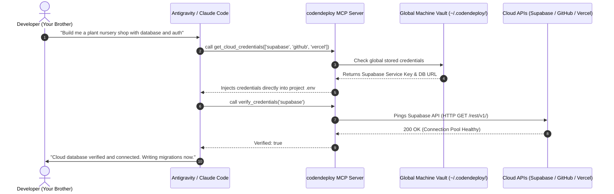
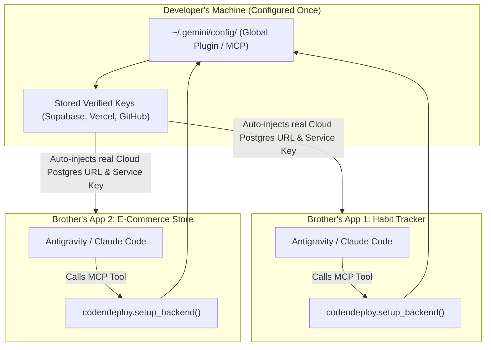
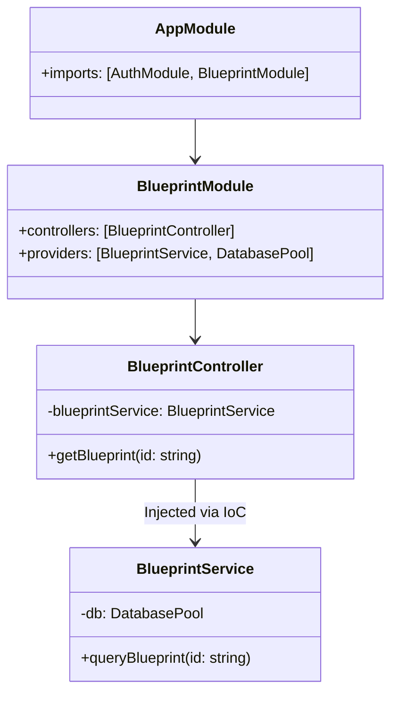
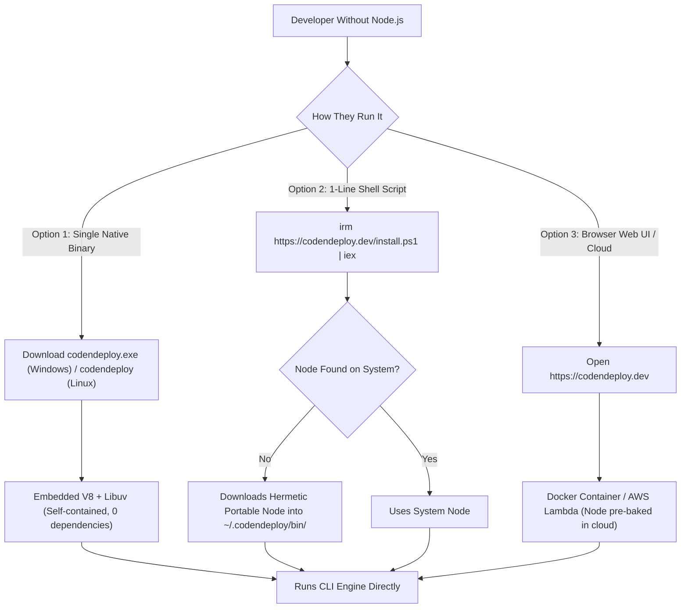
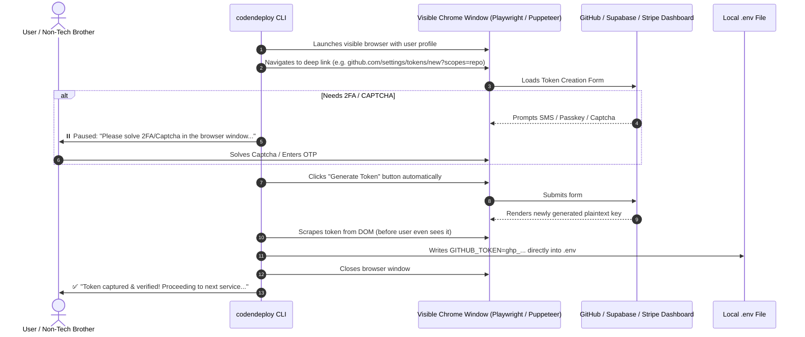
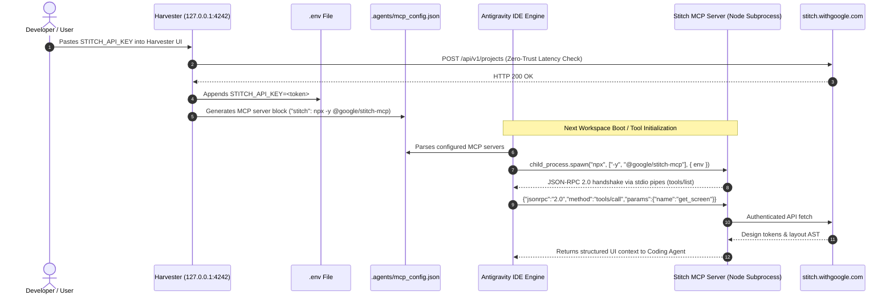
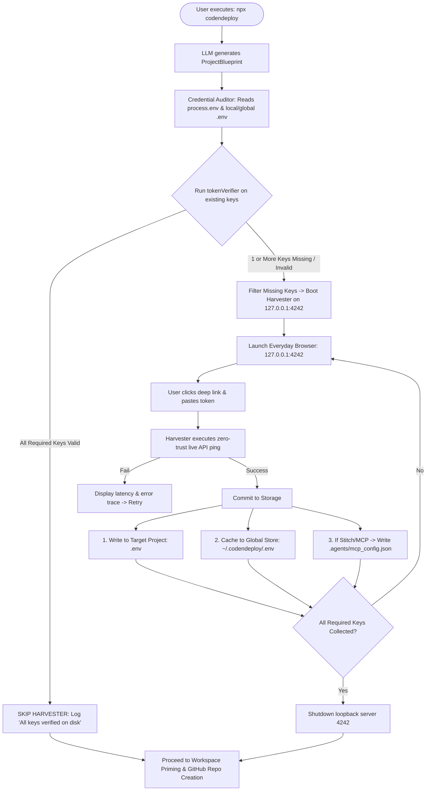

# 🗺️ System & Architecture Diagrams

This file houses graphical Mermaid diagrams for `codendeploy`. Open this document in VS Code / IDE with a Markdown Preview extension (e.g. `Markdown Preview Mermaid Support`) to render them visually.

---

## 1. The Local Database Trap vs Global MCP Architecture



---

## 2. Global Plugin Vault vs Per-Project Scaffolding



---

## 3. Local Machine vs Serverless Node.js vs Edge Isolates

```mermaid
flowchart TD
    subgraph Local["1. Local Machine Development"]
        LocalOS["Host OS (Windows / Linux)"] --> NodeExe["node.exe (Local Binary)"]
        NodeExe --> NextDev["npm run dev / next dev"]
        NextDev --> NodeHTTP["Native node:http Server"]
    end

    subgraph CloudNode["2. Production Serverless (Default: nodejs)"]
        VercelVM["Vercel / AWS Lambda Container"] --> CloudNodeRuntime["Pre-installed Node.js 20 Runtime"]
        CloudNodeRuntime --> APIRoute["app/api/.../route.ts"]
    end

    subgraph CloudEdge["3. Edge Runtime (runtime = 'edge')"]
        EdgeServer["Cloudflare / Vercel Edge PoP"] --> V8Isolate["V8 Isolate Engine (No Node.js)"]
        V8Isolate --> WebAPIs["Web Standards (fetch, Request, Response)"]
    end
```



---

## 4. NestJS Inversion of Control (IoC) & Dependency Injection Pipeline



---

## 5. Zero-Node Bootstrap Tiers (No Host Runtime Required)



---

## 6. Express.js Under the Hood: The Single `stack` Array

```mermaid
flowchart TD
    subgraph ExpressInternal["app._router.stack (Array of Layer objects)"]
        Layer0["Layer 0: express.json() (app.use)"]
        Layer1["Layer 1: cors() (app.use)"]
        Layer2["Layer 2: Auth Middleware (app.use)"]
        Layer3["Layer 3: Route Handler GET /api/blueprints (app.get)"]
        Layer4["Layer 4: Global Error Handler (err, req, res, next)"]
    end

    IncomingRequest["Incoming HTTP Request"] --> Layer0
    Layer0 -->|calls next()| Layer1
    Layer1 -->|calls next()| Layer2
    Layer2 -->|calls next()| Layer3
    Layer3 -->|calls res.json()| SentResponse["TCP Socket Closed (Client gets data)"]
    Layer2 -.->|calls next(err) on bad token| Layer4
    Layer4 -->|calls res.status(500)| ErrorResponse["Error JSON sent to client"]
```

---

## 7. The Hybrid Headful Browser Key Harvester



---

## 8. Google Stitch MCP Bridge & IPC Process Architecture



---

## 9. Key Audit, Harvester Decision, and Storage Pipeline




